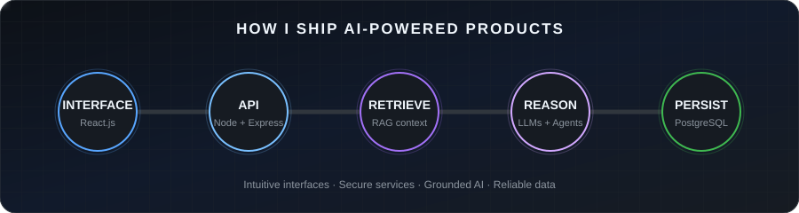
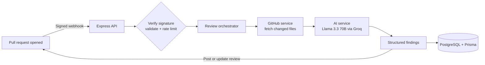
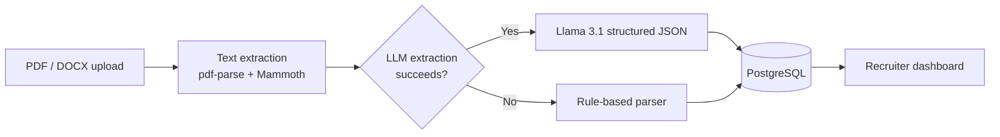

 

**I design and ship AI-powered products end to end** - from retrieval pipelines and autonomous agents 
to the interfaces and APIs that put them in people's hands.

 

<picture>
  <source media="(prefers-color-scheme: dark)" srcset="./assets/terminal-intro.svg" />
  <source media="(prefers-color-scheme: light)" srcset="./assets/terminal-intro-light.svg" />
  
</picture>

## How I build

<picture>
  <source media="(prefers-color-scheme: dark)" srcset="./assets/engineering-flow.svg" />
  <source media="(prefers-color-scheme: light)" srcset="./assets/engineering-flow-light.svg" />
  
</picture>

<table>
  <tr>
    <td width="33%" valign="top" align="center">
      <h4>Grounded AI</h4>
      Retrieval-augmented answers, structured outputs and deterministic fallbacks - not just a raw model call.
    </td>
    <td width="33%" valign="top" align="center">
      <h4>Production-minded</h4>
      Verified webhooks, validation, rate limiting and centralized error handling from day one.
    </td>
    <td width="33%" valign="top" align="center">
      <h4>Product-first</h4>
      Clean interfaces and end-to-end ownership, so intelligent features feel effortless to use.
    </td>
  </tr>
</table>

## Featured work

<a href="https://github.com/YousufS09/code-review-ai-agent">
<picture>
  <source media="(prefers-color-scheme: dark)" srcset="./assets/project-code-review.svg" />
  <source media="(prefers-color-scheme: light)" srcset="./assets/project-code-review-light.svg" />
  
</picture>
</a>

<table>
  <tr>
    <td width="50%">
      <a href="https://github.com/YousufS09/resume_parser_fe">
        <picture>
          <source media="(prefers-color-scheme: dark)" srcset="./assets/project-resume-intelligence.svg" />
          <source media="(prefers-color-scheme: light)" srcset="./assets/project-resume-intelligence-light.svg" />
          
        </picture>
      </a>
    </td>
    <td width="50%">
      <a href="https://github.com/YousufS09/InventoryManagementSystem">
        <picture>
          <source media="(prefers-color-scheme: dark)" srcset="./assets/project-inventory.svg" />
          <source media="(prefers-color-scheme: light)" srcset="./assets/project-inventory-light.svg" />
          
        </picture>
      </a>
    </td>
  </tr>
</table>

 

<strong>Under the hood: how the Code Review AI Agent works</strong>

 

<strong>Under the hood: the Resume Intelligence parsing pipeline</strong>

 

## Journey

<picture>
  <source media="(prefers-color-scheme: dark)" srcset="./assets/journey.svg" />
  <source media="(prefers-color-scheme: light)" srcset="./assets/journey-light.svg" />
  
</picture>

## Toolkit

  

## GitHub activity

<strong>Latest activity</strong> (auto-updated daily)

 

<!--START_SECTION:activity-->
<!--END_SECTION:activity-->

<picture>
  <source media="(prefers-color-scheme: dark)" srcset="https://github-readme-stats.vercel.app/api?username=YousufS09&show_icons=true&hide_border=true&theme=github_dark&rank_icon=github" />
  <source media="(prefers-color-scheme: light)" srcset="https://github-readme-stats.vercel.app/api?username=YousufS09&show_icons=true&hide_border=true&theme=default&rank_icon=github" />
  
</picture>
<picture>
  <source media="(prefers-color-scheme: dark)" srcset="https://github-readme-stats.vercel.app/api/top-langs/?username=YousufS09&layout=compact&hide_border=true&theme=github_dark" />
  <source media="(prefers-color-scheme: light)" srcset="https://github-readme-stats.vercel.app/api/top-langs/?username=YousufS09&layout=compact&hide_border=true&theme=default" />
  
</picture>

<picture>
  <source media="(prefers-color-scheme: dark)" srcset="https://streak-stats.demolab.com?user=YousufS09&theme=github-dark-blue&hide_border=true&background=0D1117&ring=8250DF&fire=58A6FF&currStreakLabel=58A6FF" />
  <source media="(prefers-color-scheme: light)" srcset="https://streak-stats.demolab.com?user=YousufS09&theme=default&hide_border=true&ring=8250DF&fire=0969DA&currStreakLabel=0969DA" />
  
</picture>

<picture>
  <source media="(prefers-color-scheme: dark)" srcset="https://raw.githubusercontent.com/YousufS09/YousufS09/output/github-contribution-grid-snake-dark.svg" />
  <source media="(prefers-color-scheme: light)" srcset="https://raw.githubusercontent.com/YousufS09/YousufS09/output/github-contribution-grid-snake.svg" />
  
</picture>

---

### Let's build something intelligent

Open to conversations about Generative AI, full-stack engineering and ambitious product ideas.

